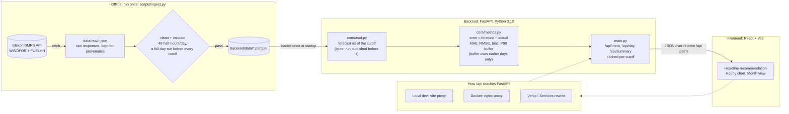

# Day-Ahead Wind Forecast Monitor

Shows a UK utility's day-ahead trading team the national wind forecast they actually had when the auction closed, and how far to trust it, so they know how much wind to count on before they buy.

**Live app:** https://reasgbh.vercel.app
**Video walkthrough:** TODO (unlisted YouTube link)
**API docs:** https://reasgbh.vercel.app/api/docs

## What it does

The team buys power on the GB day-ahead market the day before delivery, so they decide using a wind *forecast*, not actuals. The app covers the two needs in the brief:

1. **The forecast available at decision time.** For each delivery day it shows the Elexon wind forecast exactly as it stood at the auction deadline the day before: the latest forecast published before the cutoff, never a later, better one.
2. **How accurate that forecast is.** Over the month it reports bias, MAE, RMSE and the share of hours over-forecast, and turns the error into a **buffer**: how many MW to discount from the forecast to be covered 90% of the time. The buffer for each day is sized only from earlier days, exactly as a trader could have done it.

The page leads with a plain answer, for example *"For Thu 15 Jan, count on about 7,230 MW of wind"*, followed by the forecast it came from, the discount applied, and what the wind actually produced. Below that are an hourly chart for the chosen day and the month's accuracy figures with a daily error chart; clicking a day in the month chart opens it. An auction selector switches between the three day-ahead deadlines.

It is a pilot that replays purchase decisions made in January 2026. In production the same logic would run on each new day's data.

## Architecture



The data for January 2026 is historical and never changes, so it is ingested once, validated, and committed to the repo. The app never calls Elexon at runtime: it is fast, reproducible, and unaffected by Elexon outages or rate limits.

## Repository layout

```
.
├── backend/                  FastAPI service (Python 3.12)
│   ├── main.py               App entrypoint: /api/health, /api/meta, /api/day, /api/summary
│   ├── core/
│   │   ├── __init__.py
│   │   ├── asof.py           Forecast as of a decision cutoff (no look-ahead)
│   │   └── metrics.py        Accuracy metrics and the no-look-ahead buffer backtest
│   ├── data/                 Cleaned, validated parquet files (deployed with the API)
│   ├── tests/                pytest: as-of rules, metrics, API (31 tests)
│   ├── pytest.ini
│   ├── requirements.txt      Runtime dependencies
│   ├── requirements-dev.txt  Tests and ingestion dependencies
│   ├── Dockerfile
│   └── .dockerignore
├── frontend/                 React + Vite (JavaScript), Tailwind CSS, Recharts
│   ├── index.html            Page shell: title, description, font
│   ├── src/
│   │   ├── main.jsx          React entry point
│   │   ├── App.jsx           Page layout, selectors, data loading
│   │   ├── Headline.jsx      The recommendation sentence
│   │   ├── HourlyChart.jsx   Forecast vs actual vs count-on, for one day
│   │   ├── MonthSummary.jsx  Month figures and daily error chart
│   │   ├── useApi.js         Fetch hook that cancels superseded requests
│   │   ├── api.js            API paths (always relative /api)
│   │   ├── format.js         Number and UK-time formatting
│   │   ├── theme.js          Chart colours (mirrors the tokens in index.css)
│   │   └── index.css         Design tokens (Tailwind @theme)
│   ├── public/               Static files (favicon)
│   ├── package.json          Dependencies and scripts (dev, build, lint)
│   ├── eslint.config.js      Frontend lint rules
│   ├── vite.config.js        Dev: proxies /api to localhost:8000
│   ├── nginx.conf            Docker: serves the build, proxies /api to the backend
│   ├── Dockerfile
│   └── .dockerignore
├── scripts/
│   └── ingest.py             Fetches Elexon data, validates it, writes backend/data/
├── data/raw/                 Raw Elexon API responses, kept for provenance (not deployed)
├── docker-compose.yml        Runs backend + frontend locally
├── vercel.json               Vercel Services: frontend and backend in one project
├── pyproject.toml            Ruff lint and format settings
└── .gitignore
```

## Running it

### With Docker

```bash
docker compose up --build
```

Open http://localhost:8080. API docs are at http://localhost:8080/api/docs.

nginx serves the built frontend and forwards `/api` to the backend container over Docker's internal network. The backend doesn't publish a port of its own, so it can run alongside a local dev server on port 8000.

### Without Docker

Requires Python 3.12 and Node 22.

```bash
# Terminal 1: backend, from the repo root
python3.12 -m venv .venv && source .venv/bin/activate
pip install -r backend/requirements-dev.txt
cd backend && uvicorn main:app --reload --port 8000

# Terminal 2: frontend
cd frontend
npm install
npm run dev
```

Open http://localhost:5173. The Vite dev server forwards `/api` to the backend on port 8000.

### Tests and linting

From the repo root:

```bash
(cd backend && pytest)                   # 31 tests
ruff format --check . && ruff check .    # Python formatting and lint
(cd frontend && npm run lint)            # frontend lint
```

### Rebuilding the data

```bash
python scripts/ingest.py              # fetch from Elexon, validate, write backend/data/
python scripts/ingest.py --from-raw   # rebuild from data/raw/ without calling the API
```

`--from-raw` reproduces the committed parquet files byte for byte. If validation fails (a missing half-hour, or no complete forecast run before a cutoff), the script exits with an error and writes no parquet files. The raw responses are still saved, so the problem can be inspected.

## Deployment

Hosted on Vercel at https://reasgbh.vercel.app. The Vercel project is connected to this repository, so every push to `main` builds and deploys automatically. `vercel.json` defines two services in one project: `frontend` (Vite, static) and `backend` (FastAPI, Python 3.12). Requests to `/api/*` go to the backend and everything else to the frontend.

## API

| Endpoint | Returns |
|---|---|
| `GET /api/meta` | Cutoff presets, delivery days in scope, buffer quantile, error convention |
| `GET /api/day?date=2026-01-15&cutoff=09:20` | Hourly forecast (as of the cutoff) vs actual for one delivery day, the run used, that day's buffer |
| `GET /api/summary?cutoff=09:20` | Month metrics, buffer backtest summary, per-day errors |
| `GET /api/health` | Status and Python version |

`cutoff` accepts the three presets (`09:20`, `09:50`, `15:30`). Anything else returns 400; a date outside the scope returns 404.

## Data and method

**Sources (Elexon BMRS only, national wind):**
- Actuals: `FUELHH` with `fuelType = WIND`, half-hourly.
- Forecasts: `WINDFOR`, hourly, each row tagged with its `publishTime`.

**Scope.** The brief asks for purchase decisions *made* in January 2026. A decision made on day D−1 buys power for day D, so the delivery days are **2 January to 1 February**. The data also covers the alternative reading (delivery in January).

**Decision cutoffs (UK local time, the day before delivery):**

| Preset | Time | Forecast run used |
|---|---|---|
| EPEX 60-minute day-ahead auction | 09:20 | 07:30 |
| N2EX day-ahead auction | 09:50 | 09:30 |
| EPEX 30-minute day-ahead auction | 15:30 | 11:30 (once 12:25: the run published on 15 Jan, used for delivery on 16 Jan) |

Cutoffs are built in `Europe/London` and converted to UTC, so the logic stays correct across clock changes (tested on a summer date, because in January UK time equals UTC).

**Forecast as of the cutoff (`core/asof.py`).** WINDFOR publishes 8 runs a day (02:30, 04:30, 07:30, 09:30, 11:30, 15:30, 18:30, 22:30 UTC), each covering a 72-hour window. For each delivery hour the app takes the latest run published *strictly before* the cutoff. If that run didn't cover an hour, the hour falls back to an earlier run. The 09:30 run misses the 09:20 EPEX deadline by 10 minutes, and the app reflects that. A test checks that across every day and preset, no forecast used was published after its cutoff.

**Aligning resolutions.** Forecasts are hourly and actuals are half-hourly, so each pair of half-hours is averaged into an hourly actual (both halves required). No values are interpolated.

**Error convention.** `error = forecast − actual`. Positive means the forecast was too high, so a trader relying on it would have under-bought.

**Buffer (`core/metrics.py`).** For each delivery day, the buffer is the 90th percentile of signed errors from all *earlier* days (at least 3), so it uses only information available at the time. The app reports how often the actual output met "forecast minus buffer" (coverage) and how much a simple bias correction, also learned only from earlier days, would have reduced the error.

## Findings (EPEX 60-minute cutoff, 2 Jan to 1 Feb)

- The forecast ran consistently high: average bias **TODO MW**, too high in **TODO%** of hours.
- Typical miss (MAE) **TODO MW**, about **TODO%** of average output. RMSE **TODO MW**.
- The P90 buffer, sized only from earlier days, averaged about **TODO MW** and covered **TODO%** of hours against a 90% target.
- Correcting for the bias alone, learned only from earlier days, would have cut the typical miss from **TODO MW** to **TODO MW**.
- Fresher forecasts help only slightly (compare the three auction presets in the app): the error is dominated by the consistent offset, not by forecasting too far ahead.

While exploring the data, the offset also showed up in the rows each WINDFOR run includes for hours that had already passed: they sit well above FUELHH actuals for the same hours. That suggests the two datasets don't measure exactly the same thing (for example fleet coverage, curtailment, or peak rather than average output). This can't be resolved using Elexon data alone, so the app treats it as a consistent offset and quantifies it rather than explaining it.

## Design decisions

- **No database.** One month of immutable data is a few MB. Parquet files are loaded once at startup, and each cutoff's month of results is computed once and cached in memory.
- **One API path everywhere.** The frontend only calls relative `/api/...` paths. The Vite dev proxy, nginx in Docker and the Vercel Services rewrite all forward them to FastAPI, so there's no CORS setup and no environment-specific URLs.
- **Validation at ingestion, not at request time.** The API can trust its data because `ingest.py` won't write parquet files that fail validation.
- **Testing the important claims.** The tests encode the rules that matter: the strict cutoff, per-hour fallback, no look-ahead on real data, the buffer using only earlier days, and timezone handling. Mutation checks (deliberately breaking `<` into `<=`, or letting the buffer see its own day) make the tests fail, which shows they guard real behaviour.
- **Same Python everywhere.** Python 3.12 locally, in Docker and on Vercel.

## Limitations and next steps

- One month, wind only. Demand is out of scope, so the app advises how much wind to count on, not the total volume to buy.
- The buffer is one value per day. It could vary by hour of day or forecast lead time.
- Coverage sits slightly below the 90% target. A longer history would size the buffer more reliably.
- On Vercel's serverless runtime, the first request after idle takes a few seconds (a cold start). A long-running host would avoid that.
- In production, ingestion would run on a schedule after each forecast run instead of once.

## Use of AI tools

I used Claude (Anthropic) throughout as a pair programmer: to research the GB day-ahead market and the Elexon datasets, to discuss and review design decisions, and to review my code. Claude drafted parts of the code and tests, notably `core/metrics.py`, the API layer and the frontend components, and drafted this README. I wrote the ingestion script and the as-of selection with its guidance. All code was run, tested and reviewed by me, and the data findings were checked against the raw Elexon data.
